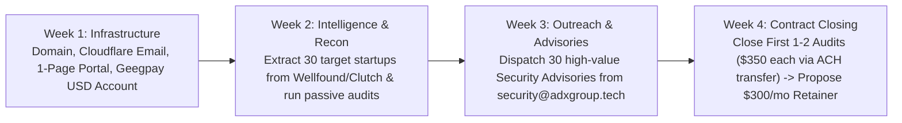

# ADX GROUP / ADX ENTERPRISE: 2026 GLOBAL MASTER PLAN
**Classification:** Internal Corporate Charter & Market Strategy  
**Entity:** ADX Group (Private Holding & Technology Solutions Enterprise)  
**Operating Architecture:** Stealth B2B Technology & Infrastructure Services  

---

## 1. Corporate Identity: What is ADX Group?

ADX Group is a private, low-profile technology holding enterprise designed to engineer high-leverage digital infrastructure, cybersecurity audits, cloud systems, and AI automation for corporate clients worldwide. 

The entity operates as an institutional B2B vendor. The public does not see an individual; they interact with an engineering organization that delivers mission-critical technical execution.

```
                           ┌────────────────────────┐
                           │       ADX GROUP        │
                           │   (Holding Enterprise) │
                           └───────────┬────────────┘
                                       │
         ┌─────────────────────────────┼─────────────────────────────┐
         ▼                             ▼                             ▼
┌───────────────────┐        ┌───────────────────┐        ┌───────────────────┐
│     ADX CYBER     │        │    ADX CLOUD &    │        │ ADX INTELLIGENCE  │
│  (Threat & Audit) │        │     SYSTEMS       │        │  (AI Automation)  │
├───────────────────┤        ├───────────────────┤        ├───────────────────┤
│ • External Audits │        │ • FastAPI Cloud   │        │ • Enterprise RAG  │
│ • DNS/DMARC Spoof │        │ • Azure/AWS Infra │        │ • Doc Search Bots │
│ • API Security    │        │ • Cron Automation │        │ • Data Pipelines  │
│ • Cloud Hardening │        │ • Uptime Sentinel │        │ • Workflow Agents │
└───────────────────┘        └───────────────────┘        └───────────────────┘
```

### The Three Operational Divisions

1. **ADX Cyber (Security & Threat Intelligence):**
   * *Mandate:* Protect mid-market businesses from data breaches, email phishing impersonation, exposed API endpoints, and regulatory compliance fines.
   * *Core Offering:* Fixed-scope external perimeter audits (\$350 – \$1,200) and Cloud Sentinel retainers (\$300 – \$600/month).
2. **ADX Cloud & Systems (DevOps & Backend Engineering):**
   * *Mandate:* Architect, containerize, and deploy fault-tolerant backend services and automated pipelines.
   * *Core Offering:* Production FastAPI/Docker deployments, automated database backup systems, and Azure/AWS cloud optimization.
3. **ADX Intelligence (Private Enterprise AI):**
   * *Mandate:* Build private, localized document retrieval systems (RAG) and workflow automation that allow companies to query their internal proprietary documents securely without leaking data.
   * *Core Offering:* Custom internal AI assistants connected to corporate knowledge bases (\$800 – \$2,500 setup).

---

## 2. 2026 Global Regional Demand Matrix: What Problems Do They Need Solved?

Every continent has distinct economic pressures, laws, and technological bottlenecks in 2026. ADX Group targets specific high-value pain points in each geography:

### A. North America (United States & Canada)
* **The Economic Reality:** High labor costs. Hiring a junior US DevOps or Security engineer costs \$90,000 – \$130,000/year. Seed and Series A startups cannot afford this overhead, but their investors and enterprise clients force them to pass strict audits.
* **The Bleeding Problems:**
  1. **SOC 2 / ISO 27001 Perimeter Compliance:** Startups cannot close enterprise deals unless their cloud infrastructure has SSL/TLS hardening, automated encrypted backups, strict IAM policies, and clean vulnerability scans.
  2. **API & Cloud Misconfigurations:** Fast-moving engineering teams deploy AWS/Azure resources in a rush, leaving S3/Blob buckets open, endpoints missing rate-limiting, and CORS misconfigured.
  3. **Cloud Runaway Costs:** Companies burning excessive funds on unoptimized cloud instances and seeking automated server right-sizing.
* **Average Deal Size:** \$500 – \$2,500 one-off audits; \$500 – \$1,500/month ongoing maintenance.

### B. Europe (United Kingdom, Germany, Netherlands, France)
* **The Economic Reality:** Europe is the most strictly regulated technology market in the world. In 2026, two massive EU/UK laws govern all software: **DORA (Digital Operational Resilience Act)** and **NIS2 (Network and Information Security Directive)**.
* **The Bleeding Problems:**
  1. **DORA & NIS2 Vendor Audits:** Financial institutions, fintechs, and supply-chain software vendors in the UK/EU face heavy government fines if they cannot prove their external digital assets and APIs are resilient against cyber attacks.
  2. **GDPR Data Leak Prevention:** Ensuring customer email records and database snapshots are not exposed on public endpoints or unprotected staging servers.
  3. **Email Authentication Mandates:** Enforced DMARC/DKIM/SPF compliance for UK/EU businesses to prevent spoofing and domain reputation blacklisting.
* **Average Deal Size:** £400 – £2,000 per technical assessment.

### C. Africa (Nigeria, Kenya, South Africa, Egypt, Ghana)
* **The Economic Reality:** Massive surge in FinTech, digital lending, logistics, and cross-border commerce. High volume of account takeover attacks, fraudulent API manipulation, and credential stuffing.
* **The Bleeding Problems:**
  1. **API Spoofing & Payment Webhook Fraud:** Malicious actors reverse-engineering mobile apps to intercept insecure API requests or spoof payment confirmation webhooks.
  2. **NDPR / POPIA Compliance:** The Nigeria Data Protection Act (NDPA) and South Africa's POPIA are aggressively fining companies whose databases or customer portals leak PII (Personally Identifiable Information).
  3. **High Infrastructure Costs in Foreign Currency:** Because AWS and Azure bill in USD, African companies need engineers who can optimize server utilization to slash monthly dollar burn.
* **Average Deal Size:** ₦350,000 – ₦1,500,000 per project.

### D. Asia & Middle East (UAE, Saudi Arabia, Singapore, India)
* **The Economic Reality:** Massive digital transformation initiatives (UAE Vision 2031, Saudi Vision 2030). Thousands of companies are migrating from legacy on-premise setups into local cloud regions (Azure UAE North, AWS Middle East).
* **The Bleeding Problems:**
  1. **Cloud Migration Security:** Securing new cloud deployments during the transition from local servers.
  2. **Phishing & Brand Impersonation:** High-net-worth real estate, trade, and logistics firms in Dubai and Singapore being targeted by sophisticated BEC (Business Email Compromise) attacks due to lack of DMARC enforcement.
* **Average Deal Size:** \$800 – \$3,500 per deployment.

---

## 3. Where Are These Contracts & Problems Posted? (The 2026 Directory)

You do not need to guess who has problems. They are published publicly on specific developer, venture, and B2B hubs daily:

| Platform / Website | Direct URL | What is Posted There & How ADX Group Uses It |
| :--- | :--- | :--- |
| **Hacker News (Monthly "Freelancer / Seeking" Thread)** | `news.ycombinator.com` | On the 1st of every month, Hacker News posts a dedicated thread: *"Ask HN: Freelancer? Seeking Freelancer?"*. High-caliber US/European startup founders post direct contracts for Python automation, cloud security, and backend engineering. Zero middleman fees. |
| **Wellfound (formerly AngelList)** | `wellfound.com` | The #1 global database of funded tech startups. Filter by: *Remote*, *Contract / Part-time*, *DevOps*, *Security*, *Backend*. Founders list exact technical headaches they need resolved immediately. |
| **Y Combinator Startup Directory** | `ycombinator.com/companies` | List of all recently funded YC startups. Check their public domains for basic security oversights (DMARC, headers) and reach out to the founders directly before their competitors do. |
| **Contra** | `contra.com` | Fast-growing, zero-commission remote agency and freelance platform. Founders post paid technical projects with direct Stripe/bank escrow payouts. |
| **We Work Remotely (Contract Section)** | `weworkremotely.com` | Navigate directly to the *DevOps and Sysadmin* and *Backend Programming* contract categories. Companies post short-term retainers for cloud and backend maintenance. |
| **Clutch.co B2B Directory** | `clutch.co` | The global phonebook of digital marketing and web agencies. Use this to locate 50 mid-sized web design agencies in London, New York, and Lagos to propose the **ADX White-Label Security Partnership**. |
| **Bugcrowd & HackerOne (Vulnerability Disclosure Programs - VDP)** | `bugcrowd.com` / `hackerone.com` | Companies post public invitations for security researchers to find flaws on their websites. Submitting vulnerabilities builds an indisputable public track record and pays out bounties (\$100 – \$1,000+ per validated bug). |
| **Disrupt Africa / TechCabal** | `disrupt-africa.com` / `techcabal.com` | Tracks every African startup that just raised seed rounds. Gives you the exact company names to contact for cloud and security hardening. |

---

## 4. The 30-Day Execution Playbook for ADX Group



### Financial Target:
* **Initial 60 Days:** 2 Perimeter Audits (\$700 total) + 1 White-Label Agency Partner (\$800/mo).
* **Target Revenue:** **\$1,500/month (approx. ₦2,300,000/month)** deposited directly into foreign USD accounts with zero public personal exposure.
