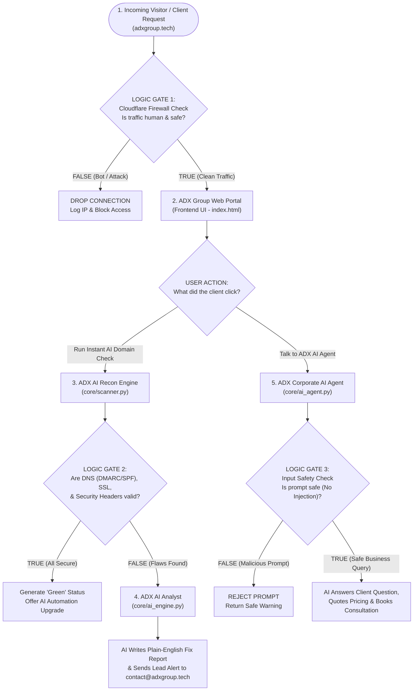

# ADX GROUP: SYSTEM ARCHITECTURE & LOGIC SCHEMATIC
**Purpose:** Complete visual blueprint ("Software Wiring Diagram") showing how ADX Group operates with Artificial Intelligence + Cybersecurity, how the True/False logic flows, and what every single code file does.

---

## 1. Why AI + Cybersecurity is the Core of ADX Group in 2026

You are 100% right: **Any technology company in 2026 that does not build with Artificial Intelligence will be left behind.**

At the same time, because every business is rushing to use AI, two massive problems have exploded worldwide:
1. **Businesses want AI Automation:** They want AI agents to answer customers, search company documents, and automate boring office tasks 24/7.
2. **AI Needs Security:** Companies are connecting AI directly to their private databases without protection. Hackers are tricking company AI bots ("Prompt Injection") into leaking customer records and API keys.

Therefore, **ADX Group** stands on two pillars linked together:
* **Pillar 1: Autonomous AI Systems** (Building smart AI workflows and assistants for businesses).
* **Pillar 2: AI-Powered Cyber Defense** (Using AI agents to automatically scan, protect, and secure client websites and AI models).

---

## 2. The Master Logic Schematic (True / False Flow Diagram)

Just like an electrical schematic shows where power flows and where switches open (`FALSE`) or close (`TRUE`), here is the exact **Software Logic Diagram** of the **ADX Group Platform**:



---

## 3. Truth Table (How the System Makes Decisions)

You can copy this table directly into your notebook. It shows the exact `TRUE` / `FALSE` conditions of how our software thinks:

| Gate # | Component | Condition Checked | If `TRUE` (1) | If `FALSE` (0) |
| :--- | :--- | :--- | :--- | :--- |
| **Gate 1** | **Edge Firewall** | Does request pass rate-limit and bot verification? | Allow into `adxgroup.tech` server. | Block request immediately at edge. |
| **Gate 2** | **Domain Scanner** | Does target website have valid SSL + DMARC + HSTS headers? | Mark asset as `PASS` (Protected). | Flag vulnerability & send to AI Engine. |
| **Gate 3** | **AI Safety Filter** | Is user's message a legitimate business/tech question? | Send to LLM API & return helpful response. | Block prompt injection attempt. |
| **Gate 4** | **Lead Dispatcher** | Did client submit a valid email and project scope? | Route notification to `contact@adxgroup.tech`. | Return validation error to form. |

---

## 4. File-by-File Code Architecture (What Every File is For)

Before we write a single line of code, here is the exact blueprint of the project folder (`adxgroup`) and the role of every file:

```text
adxgroup/
├── app.py                  <-- The Main Controller (FastAPI Backend Server)
├── core/
│   ├── scanner.py          <-- The Security Inspector (Checks SSL, DNS, Headers)
│   ├── ai_engine.py        <-- The AI Brain (Connects to LLM API to analyze data & chat)
│   └── notifier.py         <-- The Messenger (Sends client alerts to contact@adxgroup.tech)
├── templates/
│   └── index.html          <-- The Visual Face (Corporate UI, AI Chat widget, Audit tool)
├── static/
│   ├── css/style.css       <-- The Design Styling (Dark-mode enterprise theme)
│   └── js/main.js          <-- The Frontend Logic (Handles button clicks & live API calls)
└── requirements.txt        <-- The Parts List (Python libraries needed to run the system)
```

### Detailed Explanation of Each File (For Your Notes):

1. **`app.py` (The Main Distribution Board):**
   * **What it is:** The central Python server using FastAPI.
   * **What it does:** It receives requests from the website (like `/api/scan` or `/api/chat`), sends them to the right Python module in `core/`, and returns the answer to the user's screen.
2. **`core/scanner.py` (The Diagnostic Sensor):**
   * **What it is:** A passive security inspection script.
   * **What it does:** When a potential client types their website URL into `adxgroup.tech`, this file checks their SSL certificate, HTTP security headers, and email spoofing records (`DMARC`/`SPF`), returning `True` or `False` for each check.
3. **`core/ai_engine.py` (The Artificial Intelligence Core):**
   * **What it is:** The AI module powered by LLM APIs (using GitHub Models / OpenAI / Gemini).
   * **What it does:** 
     * *Job 1:* Takes the raw `True/False` results from `scanner.py` and writes a smart executive security summary explaining the business risk.
     * *Job 2:* Powers the interactive **ADX AI Consultant** on the website that answers client questions 24/7 even while you are on your 12-hour shift or sleeping.
4. **`core/notifier.py` (The Dispatch Relay):**
   * **What it is:** The communication module.
   * **What it does:** Whenever a client runs a scan or requests a project quote, it packages their details and dispatches an instant alert to `contact@adxgroup.tech`.
5. **`templates/index.html` & `static/js/main.js` (The Control Panel):**
   * **What it is:** What the customer sees in their browser when they visit `adxgroup.tech`.
   * **What it does:** Displays ADX Group's divisions, provides an interactive **"Free AI Website Security Audit"** box (which captures leads automatically), and hosts the live AI Consultant chat.
